# ASB

**Agent Switch Board** is a native switch board with GTK 4 and Libadwaita, for GNOME on Linux and for Windows. It lists your Codex and Claude Desktop Code chats and opens a chat in its own app. It also shows your OpenCode 2, Claude Code CLI, and Codex CLI sessions (view only). ASB reads the app stores read-only and makes no model calls.


## What it does

- **One board:** all your sessions in one window, with Pending attention, unread marks, pins, a drawer, and Done, Needs input, and Failed sounds.
- **All your machines:** an optional machine group adds the sessions of your other computers.
- **Your phone:** an optional Android app shows your sessions and notifications.
- **Messages:** the Messages window shows the messages that your agents send each other on all machines, with their text. The optional ASB Bridge lets Codex, Claude Code, and OpenCode sessions send messages to each other.
- **Usage:** the Usage window shows the tokens and the API price of your Codex, Claude Code, OpenCode, Antigravity, Grok, and Pi agents on all machines. ASB keeps this history with daily backups, also after the apps delete old transcripts. For the prices, the window downloads the LiteLLM price list (prices only) while you use it.
- **GNOME top bar:** an optional extension shows how many sessions need you, how many work, and how many there are.

When a session sends a message to another session, a light flies from its card to the other card:



The Messages window shows the messages between your sessions on all machines:



The Usage window shows the cost and the tokens by machine, app, and day:



## Support by app

| App | Cards | Status | Questions | Approvals | Open | Messages | Rename | Archive | Windows |
| --- | --- | --- | --- | --- | --- | --- | --- | --- | --- |
| Codex app | ✓ | ✓ | ✓ | ✗ Codex saves no approval wait | ✓ | ✓ | ✗ ASB work | ✗ ASB work | ✓ |
| Codex CLI | ✓ | ✓ | ✓ | ✗ Codex saves no approval wait | ✗ Codex saves no process ID | ✓ daemon tasks only | ✗ ASB work | ✗ ASB work | ✓ |
| Claude Desktop Code | ✓ | ✓ | ✓ | ✓ | ✓ | ✓ | ✗ Anthropic: no entry point | ✗ Anthropic: no entry point | ✓ |
| Claude Code CLI | ✓ | ✓ | ✓ | ✓ | ✗ ASB work: terminal tab | ✓ | ✗ ASB work | ✗ Anthropic: no archive | ✓ |
| OpenCode 2 | ✓ | ✓ | ✗ OpenCode: memory only | ✗ OpenCode: memory only | ✗ OpenCode: no session link | ✓ no reference sends to it | ✗ ASB work | ✗ ASB work | ✓ |
| Claude Code on the web | ✓ Claude app cache | ✓ fresh cache only | ✓ one signal | ✓ one signal | ✓ | ✗ Anthropic: cloud only | ✗ Not planned: login | ✗ Not planned: login | ✗ ASB work: cache format |

✓ works. ✗ not yet: the note says what it waits on. "ASB work" means only ASB code is missing. Rename and Archive mean from the board.
All apps also have Read and Unread, pins, the drawer, Mute, Discard, sounds, and the phone. Cards of other machines do not open and have no Discard.

## Install on Linux

Needs Node.js `>=20` (`sqlite3` below `22.13`), Python 3 with PyGObject, GTK `>=4.12`, Libadwaita `>=1.4`, `xdg-utils`, and `openssl`.
Install Codex and Claude Desktop first, with working `codex:` and `claude:` URL handlers.

### Install with npm

```bash
npm install -g --install-links github:Jamir-boop/ASB
asb setup
```

Keep `--install-links`: npm 11 needs it. `asb setup` asks what to set up: the board, ASB Bridge, or both (`--only board`, `--only bridge`).
The [full install guide](docs/INSTALL.md) has the system checks, the distribution and release packages, and engine-only use.

## Install on Windows

Use the same npm commands with Node.js `22.13` or later. The board window needs MSYS2 Python with PyGObject, GTK `>=4.12`, and Libadwaita `>=1.4`. See [Windows setup](docs/INSTALL.md#install-on-windows).

## Optional parts

- [Android app](android/README.md): your sessions, notifications, message counts, and usage on your phone. Phone access is off by default.
- [ASB Bridge](bridge/README.md): messages between Codex, Claude Code, and OpenCode sessions. The ASB `1.13.0` packages have ASB Bridge `0.8.0`. See [setup and recovery](docs/INSTALL.md#asb-bridge-optional).

[User guide](ASB.md) · [Privacy](docs/PRIVACY.md) · [Source setup](ASB.md#start-and-stop) · [Contributing](CONTRIBUTING.md) · [Install guide](docs/INSTALL.md)

## Credits

- Based on [Agent Mission Control 0.6.0](https://github.com/forxidian/agent-mission-control/releases/tag/v0.6.0) by **forxidian**.
- ASB Bridge is based on claude-uds-bridge by Leon Kohli (MIT). See [bridge/LICENSE](bridge/LICENSE).
- The sounds are audio from opencode, commit `fe87944b6ae85422db64c751b6d6ee488b0d7f1c` (MIT, Copyright (c) 2025 opencode). The PC copies in `assets/sounds/` are louder than the originals; the Android app uses the original files. See [assets/sounds/opencode-LICENSE.txt](assets/sounds/opencode-LICENSE.txt).

[MIT license](LICENSE).
