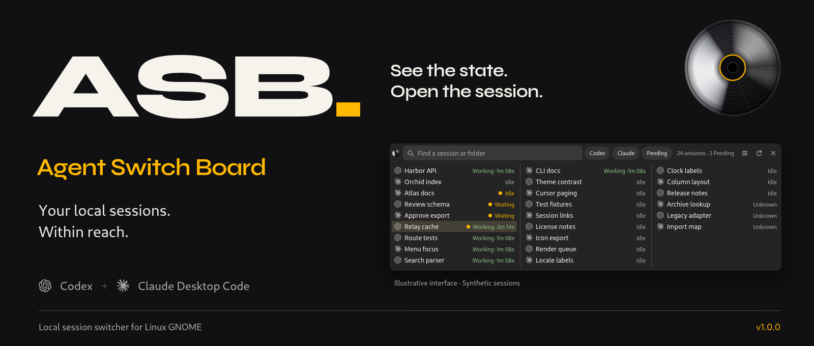

# ASB

**Agent Switch Board** is a native GNOME switcher for your Codex and Claude Desktop Code chats. Select a chat to open it in its original app. ASB makes no model calls.



https://github.com/user-attachments/assets/c85742f4-d1b0-4ffc-9497-144069fec36b

## Install on Linux

[Download v1.8.1](https://github.com/Jamir-boop/ASB/releases/tag/v1.8.1) · [Release notes](docs/releases/v1.8.1.md) · [Checksums](https://github.com/Jamir-boop/ASB/releases/download/v1.8.1/SHA256SUMS)

Needs Node.js `>=20` (`sqlite3` below `22.13`), Python 3 with PyGObject, GTK `>=4.12`, Libadwaita `>=1.4`, and `xdg-utils`. The current source also needs `openssl` for the phone certificate. The optional `python3-qrcode` shows the phone pairing QR code.

Install Codex and Claude Desktop first, with working `codex:` and `claude:` URL handlers.

**Debian:** [asb_1.8.1_all.deb](https://github.com/Jamir-boop/ASB/releases/download/v1.8.1/asb_1.8.1_all.deb)

```bash
sudo apt install ./asb_1.8.1_all.deb
asb
```

**Portable (per-user):** [asb-1.8.1-linux.tar.gz](https://github.com/Jamir-boop/ASB/releases/download/v1.8.1/asb-1.8.1-linux.tar.gz)

```bash
tar -xzf asb-1.8.1-linux.tar.gz
cd asb-1.8.1
./install.sh
~/.local/bin/asb
```

[User guide](ASB.md) · [Privacy](docs/PRIVACY.md) · [Source setup](ASB.md#start-and-stop) · [Contributing](CONTRIBUTING.md)

## Android companion (optional)

The ASB Android app shows your sessions on your phone over your local network, or away from home through ZeroTier or Tailscale. It can open a chat on the PC, use the row actions, and change Persistent unread. It shows Done, Failed, and Needs input notifications.

Phone access is off by default. In ASB, open Preferences > Phone, select **Allow phone access**, select one or more addresses (Home network, ZeroTier, or Tailscale), and select **Apply**. Then select **Pair a phone** and scan the QR code with the app. Compare the certificate fingerprint on the PC and the phone. See the [Android guide](android/README.md) to build and install the app.

## Run without the window (optional)

`asb service install` installs and starts the `asb.service` systemd user service. It runs the ASB server and phone access without the window, so the phone stays connected when you close the window. `asb service status` shows the service state. `asb service uninstall` stops and removes it. While the service runs, the ASB window attaches to it. An ASB `1.8.1` or older window cannot attach and reports a port conflict.

The current source includes the Android companion and the user service; published `1.8.1` packages do not.

## ASB Bridge (optional)

ASB Bridge lets local Claude Code sessions and Codex tasks message each other. When ASB Bridge is installed, a message that one agent sends starts a turn in the receiving app.

The current source includes the bridge; published `1.8.1` packages do not. It needs Bun. From a source checkout, run `scripts/asb bridge install --all`. With a package built from this source, run `asb bridge install --all`. Then open Plugins > ASB Bridge in Codex, trust both hooks, and restart Codex. Without a target flag, `asb bridge install` shows usage and changes nothing. See the [bridge guide](bridge/README.md) for explicit targets and the on-demand skills.

Codex starts the required bridge server with `bun` from the PATH of the Codex app. If that app cannot start Bun, Codex cannot start or resume tasks. To recover, run `asb bridge uninstall --codex-home <home>` for the affected home; this command does not need Bun. Then make Bun visible to desktop apps, for example with a link in `~/.local/bin` on Linux if that directory is on the app's PATH. Restart Codex and install the bridge again. `asb bridge status` checks the PATH of running Codex app-server processes on Linux and warns when Bun is missing.

ASB Bridge is based on claude-uds-bridge by Leon Kohli (MIT). See [bridge/LICENSE](bridge/LICENSE).

ASB plays Done, Needs input, and Failed sounds on the PC. The sounds are unchanged audio from opencode, commit `fe87944b6ae85422db64c751b6d6ee488b0d7f1c` (MIT, Copyright (c) 2025 opencode). See [assets/sounds/opencode-LICENSE.txt](assets/sounds/opencode-LICENSE.txt).

Based on [Agent Mission Control 0.6.0](https://github.com/forxidian/agent-mission-control/releases/tag/v0.6.0) by **forxidian**. [MIT license](LICENSE).
