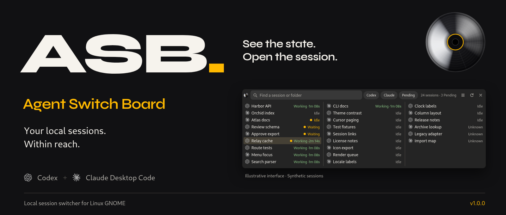

# ASB

**Agent Switch Board** is a native switch board with GTK 4 and Libadwaita, for GNOME on Linux and for Windows. It lists your Codex and Claude Desktop Code chats and opens a chat in its own app. It also shows your OpenCode 2, Claude Code CLI, and Codex CLI sessions (view only). ASB reads the app stores read-only and makes no model calls.




## What it does

- **One board:** all your sessions in one window, with Pending attention, unread marks, pins, a drawer, and Done, Needs input, and Failed sounds.
- **All your machines:** an optional machine group adds the sessions of your other computers.
- **Your phone:** an optional Android app shows your sessions and notifications.
- **Messages:** the Messages window shows the messages that your agents send each other on all machines, with their text. The optional ASB Bridge lets Codex, Claude Code, OpenCode, and Antigravity CLI sessions send messages to each other.
- **Usage:** the Usage window shows the tokens and the API price of your Codex, Claude Code, OpenCode, Antigravity, Grok, and Pi agents on all machines, and the sessions that cost the most. ASB keeps this history with daily backups, also after the apps delete old transcripts. For the prices, the window downloads the LiteLLM price list (prices only) while you use it.
- **GNOME top bar:** an optional extension shows how many sessions need you and how many work, with no count of all sessions.

When a session sends a message to another session, a light flies from its card to the other card:



Preferences > Appearance > **Pets** sends a pixel crab, pigeon, or cat with each message instead. The Android app has the same setting.

To mute a session for a time, rest the pointer on the bell button of its card, turn the wheel to choose 30 min, 1 hour, 8 hours, 1 day, or Always, and click. The card shows the time left, and the mute ends by itself:



The Messages window shows the messages between your sessions on all machines:



The Usage window shows the cost and the tokens by machine, app, and day:



The GNOME top bar and the Android app show the same counts, and Read on the phone clears the mark on the PC:


## Answer questions from the phone

The Android app can answer questions from the Codex app, Codex CLI, Claude Desktop Code, Claude Code CLI, Antigravity CLI (agy), and OpenCode 2 on the paired PC. Antigravity CLI phone answers need Linux and kitty remote control. Not tested end to end on Windows. On main, not in a release yet.

1. In Preferences > Phone, turn on **Send message text to phones**, then **Answer questions from phones** (off by default). Phone access must be on, with a paired phone.
2. Run `asb agent claude-hook install` for Claude, `asb agent agy-hook install` for agy, or `asb bridge install --opencode` for OpenCode 2. The Claude install adds one hook to the Claude settings of each Claude profile that ASB reads, and keeps the old file as `settings.json.asb-backup`. `asb agent claude-hook status` shows the state, and `asb agent claude-hook remove` takes the hook out.
3. Update the phone app: the question card is in the app from this build on. A tap on a Needs input notification opens it.

The card stays on the PC too, and the first answer wins. For agy sessions in a kitty with remote control, ASB verifies the agy question form on the kitty screen and types the phone answer into it; if the form changed or is gone, the phone shows an error and you answer on the PC. For OpenCode 2, choice forms (1 to 4 single-choice or multi-select fields, 1 to 8 options each) get a phone card; forms with a free-text field or other field kinds stay on the PC (not tested end to end on a phone with a real OpenCode session). A long wait works (checked with an answer after 4,000 s). With the answer switch on, each paired phone can answer for your agents: unpair a lost phone in Preferences > Phone.

For the Codex app and CLI, use ASB Bridge with a session on the shared Codex app-server. Codex shows `request_user_input` in Plan mode. In Default mode it shows these questions only with the `default_mode_request_user_input` feature on. Secret questions and questions without options stay on the PC only. After you update the phone app, it hides **Other** when the question does not allow it. Checked end to end on 2026-11-23 with the Codex CLI 0.171.0 on the shared app-server in Plan mode, through the phone answer route (the answer reached the model); the Codex app was not checked.

- An engine restart ends the phone path of an open question: answer it on the PC.
- Run `asb agent claude-hook remove` before `asb uninstall`.
- This feature is for local sessions. It does not apply to the sessions of group members.

## Approve Claude Code requests from the phone

On Linux and Windows, a paired phone can allow or deny the tool requests and approve the plans of Claude Code sessions. On main, not in a release yet. In Preferences > Phone, turn on **Approve requests from phones** (off by default, under **Answer questions from phones**). It needs phone access on, **Send message text to phones** on, **Answer questions from phones** on, and a paired phone. Run `asb agent claude-hook install` again: it now writes one `PermissionRequest` entry with matcher `*` (it replaces the older `AskUserQuestion` entry), and keeps `settings.json.asb-backup`. Until you run it again, `asb agent claude-hook status`, the Phone page, and `asb doctor` say `questions only`.

The card shows the tool name and a few display lines (for Bash the command and its description, for Write or Edit the file, for an MCP tool the server name and only the input key names, never the values, and for each other tool its input key names). A plan card shows the plan text and `After approval: Bypass permissions mode, if this session allows it`. The note field says `Note for the agent (sent with Deny)` on a tool card and `Note for the agent (sent with Keep planning)` on a plan card. Allow runs the tool and closes the PC dialog. Deny does not run the tool, closes the PC dialog, and sends `Denied from the phone.` or `Denied from the phone: <note>`. `Approve plan` allows the plan and asks Claude Code to set bypassPermissions mode for the session; `Keep planning` sends `Keep planning.` or `Keep planning: <note>` and stays in plan mode.

After `Approve plan` from a phone, a session that allows bypass mode runs its next tools with no dialog and no card, so a paired phone can start work that nobody approves step by step; this is the main risk of the feature.

Limits:
- A card comes only when Claude Code itself shows a permission dialog. In auto, dontAsk, and bypassPermissions mode no dialog shows, so no card.
- `Approve plan` sets bypass mode only if the session was started with bypass mode available; else the session stays in Manual mode and each next tool asks again. A plan over 16,000 characters, or a plan request from a subagent, gets no card. A session started in bypass mode can end plan mode with no `ExitPlanMode`, so with no card.
- No card, so the request stays on the PC: a tool name with a control or hidden character; a Bash command, file path, or notebook path over 4,000 characters; a URL over 2,000 characters; or one of these with a control or hidden character (a tab and a newline are allowed).
- The PC wins. When you answer on the PC, the open phone card closes in place at the next phone read (`This request is closed.`, both buttons off; at most 30 s). `Answered on the PC` shows only if you tap a button after the PC answered. A phone answer after a PC answer changes nothing for the tool.
- If the engine stops during a wait, the hook ends with no output and the PC dialog stays and works. The phone shows `Offline` with the buttons off until it reaches the PC again, then the card closes.
- One card for each session: a newer request replaces the older one on the phone; the older one stays on the PC only.
- The alert and the `Waiting` state come from the row's attention marks, not the card data. The card can appear before Waiting and before a phone alert. A permission dialog shows Waiting and can cause a Needs input sound and a phone alert only after it stays open 10 s. A request you answer at once does not alert. The phone alert was measured once: about 14 s after the dialog opened (the 10 s rule plus one phone read), with the app in the background. The app posts no alert while it is open on the screen. With no working row and no new request in the last 60 s, the phone reads the PC each 30 s, so the first card can be up to 30 s late; the time with the screen off is not proven.
- Checked with Claude Code 2.1.330 on Linux: a CLI session end to end with a real Android phone (2026-11-23), and a desktop Code tab session for one tool allow and one tool deny (2026-11-22). The desktop Code tab is not checked for plans.
- An older ASB build reads the `*` entry as `other launcher`. Not yet: group members and Antigravity CLI. Not tested end to end on Windows.
- Each permission dialog waits about 70 ms for the hook, also with the switch off.
- Claude Code sessions that already run keep the old hook entry until they start again (by the Claude Code docs; not tested).

## Approve OpenCode requests from the phone

On main, not in a release yet. Use ASB Bridge `0.10.0` with OpenCode 2 on Linux or Windows.

1. Run `asb bridge install --opencode`. OpenCode loads the plugin by itself. In one observation (OpenCode 2.4.0) a session that ran took the new plugin with no restart. If a session shows no card, start OpenCode again.
2. In Preferences > Phone, turn on **Allow phone access**, **Send message text to phones**, **Answer questions from phones**, and **Approve requests from phones**. Pair a phone.

- A shell permission request can show `Command` and `Folder`. A `write` or `edit` permission request for one file can show `File` (the resolved path) and `Size` (the content length or the old and new text lengths). A subagent request shows `for a subagent` in the title on the root session's card.
- Other types of permission request get no approval card. OpenCode question forms use the question card (see Answer questions from the phone). A permission request stays on the PC if the plugin cannot match it to its tool input, or if a command, folder, or path is over 4,000 characters or has control or hidden characters (tabs and newlines are allowed).
- `Allow once` lets OpenCode run the tool once, not always. `Deny` rejects the request and sends `Denied from the phone.` or `Denied from the phone: <note>` to OpenCode.
- With no paired phone, a switch off, or the engine down, use the PC dialog. If you answer there first, the plugin stops its phone wait. Only one card can be open on the phone for each session. A newer request replaces the older card.
- A card comes only when OpenCode itself asks for permission. A rule that allows the tool (for example a global `allow` for all) gives no dialog and no card.
- The phone can act only on local sessions. Not tested end to end on Windows or on a phone with a real OpenCode session.

## Approve Codex commands from the phone

On Linux and Windows, run `asb agent codex-hook install` to add the optional hook for the Codex CLI and the Codex app's app-server. It is not installed by default. In the CLI, at `Hooks need review`, use `Review hooks` to find the ASB `PermissionRequest` hook. Select `Trust all and continue` only if you trust all the hooks shown. If you select `Continue without trusting`, Codex skips the hook and uses its normal approval path. The `^Bash$` matcher limits the hook to `Bash` approvals. Run `asb agent codex-hook remove` to remove it. Run `asb agent codex-hook status` to check each enabled Codex home. ASB cannot see if Codex trusts the hook: the state `installed` does not mean that Codex runs it.

While **Approve requests from phones** is on and a paired phone was seen in the last 60 s, each Codex Bash command that asks for approval goes to the phone before the Codex reviewer. If you allow the command on the phone, Codex skips the reviewer. If you deny the command, Codex blocks it. Codex sends the denial and any note to the model in the tool result. The phone card stays open for 28 s (`CODEX_FIRST_MS` in `src/claude-questions.mjs`). During that time the PC shows `Running hook` with no approval buttons (the hook client stops waiting at 30 s). If the phone does not answer, Codex decides with its own settings: with `approvals_reviewer = "auto_review"`, the Codex automatic reviewer decides and can allow the command with no dialog on the PC; else Codex shows its PC dialog. Codex 0.171 asks for approval only for an escalation request (for example with `-a on-request`). A command that fails in the sandbox gives no request and no card. Each held command plays the Needs input sound on the PC and can alert on the phone, even if the automatic reviewer would allow it.

The first command of a new session can get no card. The first command after a time with no working session can reach the phone up to 30 s late, or not at all. Unlisted threads and subagent threads get no card. If two requests from one session overlap, only the newer one stays on the phone. The older one goes to the normal approval path. Until the phone app update that alerts again for a new request, a second card can come with no alert. The time with the screen off is not proven. The hook adds about 190 ms per Bash approval when it does not hold the command. A command over 4,000 characters gets no card. Codex app: the hook ran in the app's own build (`0.171.0-alpha.13`) with a loopback model fixture. The live app UI was not tested. Not tested end to end on Windows.

## Antigravity CLI

ASB lists Antigravity CLI (agy) sessions from the records of an agy hook and shows their state. On main, not in a release yet. A live row in a kitty with remote control opens by focusing its kitty window. ASB counts each agy subagent on the card of the session that started it and does not show a separate card. agy hooks do not give the parent session, so ASB uses this rule: a new conversation that starts in the agy process of one working session is a subagent of that session.

Run `asb agent agy-hook install` to add the hook. It writes one `asb` key into `~/.gemini/config/hooks.json`, keeps the old file as `hooks.json.asb-backup`, and leaves other hooks as they are. `asb agent agy-hook status` shows the state, and `asb agent agy-hook remove` takes the hook out. Linux only.

`asb agent agy-hook install` also sets agy's window title command (`title` in `~/.gemini/antigravity-cli/settings.json`) to `asb agent agy-title`, unless you have your own `title` setting. After you name a conversation with `/rename`, the board shows that name as the row title, and the kitty window title shows it too (`agy · <folder>` before a rename). `remove` takes the setting out.

Focus needs kitty remote control in your `kitty.conf`. Use these two lines (`asb doctor` prints them):

```
allow_remote_control socket-only
listen_on unix:${XDG_RUNTIME_DIR}/kitty-{kitty_pid}
```

This is a file socket in your runtime folder, so only your user can connect to it. Do not use an abstract socket (`unix:@name`): each local process of each user can connect to it and control kitty (checked with kitty 0.41.1). ASB uses `focus-window` to open a live row.

Limits:
- Checked with agy 1.5.14 and kitty 0.41.1 on X11; Wayland is not checked.
- agy has no hook event for a command approval, so ASB shows Working, not Waiting, while agy waits for one.
- Esc fires no hook event. After 10 minutes with no event and no transcript change, a Working row shows Unknown.
- If you deny an MCP tool call (and probably if you press Esc), agy 1.5.15 ends the turn without a Stop hook and the record stays `working` until the next turn ends; the board shows Working (then Unknown after 10 minutes with no news), kitty does not type, and a message still waiting after 60 min is withdrawn with a drop receipt.
- `/exit` and a crash fire no hook event; ASB sees the end from the agy process. A crash during a task shows Unknown, with no Failed sound.
- Each agy hook call adds about 80 ms, and agy waits for it.
- Not yet: phone approvals, Windows, and the Antigravity app and IDE.

### ASB Bridge for agy

On Linux, install the ASB agy hook, then run `asb bridge install --agy` with agy and Bun on `PATH`. Start a new agy session. It shows to other agents after its first turn. `asb bridge status` checks the installation. `asb bridge uninstall --agy` removes it.

Use the `asb-bridge` MCP tools to list peers and send to one peer by its session ID or reference. agy shows "Allow calling this tool?" for each Bridge tool call unless you allow that tool always. To reply with `send_message`, allow this tool each time agy asks. A deny interrupts the turn. A worker needs you there unless you choose an "always" option in agy. The MCP allow prompt with `--dangerously-skip-permissions` is not tested. Another agent can send to agy by session ID. When kitty typing cannot deliver a message, the message can arrive through the `Stop` hook at the end of a turn. If agy stays idle and kitty typing cannot deliver it, the message waits. ASB does not need kitty for the Stop path. The Stop path delivers every input kind, including idle notices, and each one starts a model turn on your agy account, as in Codex and OpenCode. In a session started with `--dangerously-skip-permissions`, a message delivered through Stop can run tools with no agy permission prompt.

Claude Code 2.1.330 holds a peer message for your review when the receiving Claude session runs in bypass mode and the sender does not state the same permission mode. An agy sender states no mode, so a Bridge message from agy to a Claude session in bypass mode waits in that Claude session until you approve it. ASB Bridge gets no notice of the hold: the row of the sent message stays `socket-written`. To deliver the messages of all your sessions in all modes, set `"crossSessionInbound": "accept"` in the Claude `settings.json` (`/config`: "Messages from your other sessions"). Then messages from any sender reach Claude with no review, also in a session that runs commands without asking.

Checked live once with agy 1.5.15 (2026-11-23): `list_sessions` through MCP, and one message delivered at Stop. Tests use fakes for withdrawal at 60 min, `unknown` outcomes, two receivers, and release from hold.

Kitty typing is on after `asb bridge install --agy` for agy sessions in a kitty with remote control on a file socket. ASB reads the prompt screen in memory only and types into that kitty window. Kitty typing accepts a framed message of at most 8 lines and 500 characters. For a longer message, ASB types one fixed line into the idle agy prompt (`[ASB Bridge] A peer message is waiting. It arrives when this turn ends. Reply with only OK.`), with no peer data, and the message arrives through the Stop hook at the end of that turn. A long message costs two model turns on your agy account. If ASB cannot verify the typed line, it does not press Return, and the message waits for the next Stop. If ASB cannot verify the pasted text, it does not press Return. The text stays in the agy prompt as a draft. The receiver records `unknown` and sends no delivery receipt. In a session started with `--dangerously-skip-permissions`, a message typed this way can run tools with no agy permission prompt. `asb bridge uninstall --agy` turns off kitty typing. Checked live once with agy 1.5.15 (2026-11-23): ASB typed and submitted one message through kitty. A typed draft kept a second message out of the prompt. The paste check refused while the "Allow calling this tool?" dialog showed. The live check also covered pasting `@` and `/`. Tests use fakes for other kitty cases.

## Support by app

| App | Cards | Status | Questions | Approvals | Phone answers | Open | Messages | Background | Usage | Rename | Archive | Windows |
| --- | --- | --- | --- | --- | --- | --- | --- | --- | --- | --- | --- | --- |
| Codex app | ✓ | ✓ | ✓ | ✓ with ASB Bridge | ✓ with ASB Bridge and the shared Codex app-server | ✓ | ✓ | ✓ subagents only | ✓ | ✗ ASB work | ✗ ASB work | ✓ |
| Codex CLI | ✓ | ✓ | ✓ | ✓ with ASB Bridge, daemon tasks only | ✓ with ASB Bridge and the shared Codex app-server | ✗ ASB work: terminal tab | ✓ daemon tasks only | ✓ subagents only | ✓ | ✗ ASB work | ✗ ASB work | ✓ |
| Claude Desktop Code | ✓ | ✓ | ✓ | ✓ | ✓ with the hook | ✓ | ✓ | ✓ | ✓ | ✗ Anthropic: no entry point | ✗ Anthropic: no entry point | ✓ |
| Claude Code CLI | ✓ | ✓ | ✓ | ✓ | ✓ with the hook | ✗ ASB work: terminal tab | ✓ | ✓ | ✓ | ✗ ASB work | ✗ Anthropic: no archive | ✓ |
| OpenCode 2 | ✓ | ✓ | ✓ with ASB Bridge | ✓ with ASB Bridge | ✓ with ASB Bridge | ✗ ASB work: terminal tab | ✓ no reference sends to it | ✓ | ✓ | ✗ ASB work | ✗ ASB work | ✓ |
| Antigravity CLI | ✓ with the hook | ✓ with the hook | ✓ with the hook | ✗ Google: no event | ✓ Linux, with the hook and kitty remote control | ✓ live kitty sessions, with remote control | ✓ ASB Bridge; idle kitty with a file socket or at Stop | ✗ Not checked | ✓ | ✗ Not checked | ✗ Not checked | ✗ ASB work |
| Claude Code on the web | ✓ Claude app cache | ✓ fresh cache only | ✓ one signal | ✓ one signal | ✗ Not planned: login | ✓ | ✗ Anthropic: cloud only | ✗ Anthropic: cloud only | ✗ Anthropic: cloud only | ✗ Not planned: login | ✗ Not planned: login | ✗ ASB work: cache format |

✓ works. ✗ not yet: the note says what it waits on. "ASB work" means only ASB code is missing. Rename and Archive mean from the board.
Background counts the commands and subagents that a session runs in the background now. It is an option in Preferences > Appearance and in Android Settings, off by default.
Usage is the tokens and the API price of the session in the Usage window.
All apps also have Read and Unread, pins, the drawer, Mute for a time (30 min to Always), Discard, Copy (relative reference, absolute reference, or name), sounds, the GNOME top bar, and the phone. Cards of other machines do not open, have no Discard, and copy only the absolute reference or the name.

## Install on Linux

Needs Node.js `>=20` (`sqlite3` below `22.13`), Python 3 with PyGObject, GTK `>=4.12`, Libadwaita `>=1.4`, `xdg-utils`, and `openssl`.
Install Codex and Claude Desktop first, with working `codex:` and `claude:` URL handlers.

### Install with npm

```bash
npm install -g --install-links github:Jamir-boop/ASB
asb setup
```

Keep `--install-links`: npm 11 needs it. `asb setup` asks what to set up: the board, ASB Bridge, or both (`--only board`, `--only bridge`).
The [full install guide](docs/INSTALL.md) has the system checks, the distribution and release packages, and engine-only use.

## Install on Windows

Use the same npm commands with Node.js `22.13` or later. The board window needs MSYS2 Python with PyGObject, GTK `>=4.12`, and Libadwaita `>=1.4`. See [Windows setup](docs/INSTALL.md#install-on-windows).

For phone answers or approvals, run `asb.cmd agent claude-hook install` or `asb.cmd agent codex-hook install` in a terminal under the same Windows account as the ASB engine. The Codex hook is for command approvals. Codex questions and OpenCode 2 forms use ASB Bridge. The installers use `%APPDATA%\npm\asb.cmd` or find `asb.cmd` on `PATH`. Start new Claude Code sessions after installing the hook. Use the Phone switches in Preferences as on Linux. Run the corresponding `remove` commands before uninstalling ASB. Not tested end to end on Windows.

## Optional parts

- [Android app](android/README.md): your sessions, notifications, message counts, and usage on your phone. Phone access is off by default.
- [ASB Bridge](bridge/README.md): messages between Codex, Claude Code, and OpenCode sessions. The ASB `1.16.0` packages have ASB Bridge `0.9.0`. See [setup and recovery](docs/INSTALL.md#asb-bridge-optional).

[User guide](ASB.md) · [Privacy](docs/PRIVACY.md) · [Source setup](ASB.md#start-and-stop) · [Contributing](CONTRIBUTING.md) · [Install guide](docs/INSTALL.md)

## Credits

- Based on [Agent Mission Control 0.6.0](https://github.com/forxidian/agent-mission-control/releases/tag/v0.6.0) by **forxidian**.
- ASB Bridge is based on claude-uds-bridge by Leon Kohli (MIT). See [bridge/LICENSE](bridge/LICENSE).
- The sounds are audio from opencode, commit `fe87944b6ae85422db64c751b6d6ee488b0d7f1c` (MIT, Copyright (c) 2025 opencode). The PC copies in `assets/sounds/` are louder than the originals; the Android app uses the original files. See [assets/sounds/opencode-LICENSE.txt](assets/sounds/opencode-LICENSE.txt).

[MIT license](LICENSE).
