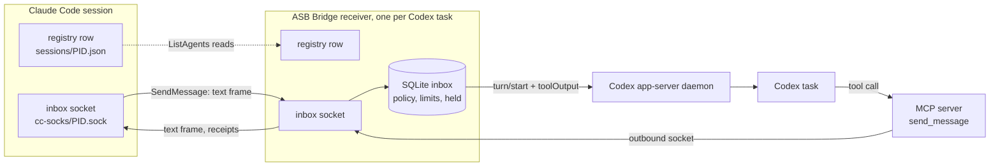

# ASB Bridge

A plugin that lets Codex tasks, Claude Code sessions, and OpenCode 2 sessions message each other on one machine and, in an ASB machine group, with the sessions on your other machines (Linux and Windows).

Claude Code lists and messages its other sessions through its own local registry. This plugin registers each Codex task and each OpenCode session in that registry, so Claude finds them with `ListAgents` and writes to them with `SendMessage`. Claude needs no flags, plugins, or launchers. A bundled MCP server gives the Codex side `list_sessions` and `send_message`. Messages travel over Unix domain sockets in private per-user directories. On Windows they travel over named pipes, and each receiver has a key file and checks an `auth` line (see [Windows](#windows)).

Separate Claude profiles have separate registries by default. To share discovery and messaging, use the explicit setup below.

## Requirements

- Stock Codex with its shared local app-server daemon. CLI tasks on the daemon and desktop tasks it owns work. Older desktop tasks use the desktop IPC fallback. CLI sessions started with `--no-daemon` have no inbox. Real-runtime checks cover Codex 0.159.0, 0.159.2, and 0.159.3.
- Linux, macOS, or Windows.
- Claude Code 2.1.224 or later, the first release with [cross-session messaging](https://code.claude.com/docs/en/cross-session-messaging).
- Bun on the PATH of both your terminal and the Codex app. OpenCode does not need Bun: it loads the plugin bundle by itself.
- OpenCode 2.1.2 or later, for the OpenCode plugin. The desktop app 2.1.2 ships it.

## Install

Install the plugin and both usage skills with ASB. Bun must be on your `PATH`.

Codex starts the bridge server with `bun` from the PATH of the Codex app. The server stays `required: true` because the `SessionStart` hook needs it before the first turn. If Codex cannot start Bun, it cannot start or resume tasks. See OpenAI's [required MCP setting](https://learn.chatgpt.com/docs/config-file/config-reference).

To recover, run `asb bridge uninstall --codex-home <home>` for the affected home. Uninstall needs Codex but does not need Bun. Then make Bun visible to desktop apps, for example with a link in `~/.local/bin` on Linux if that directory is on the app's PATH. Restart Codex and install the bridge again.

```bash
asb bridge install --codex-home ~/.codex --claude
asb bridge install --opencode
asb bridge install --opencode --opencode-config /path/to/opencode/config
```

Use `asb bridge install --all` for all detected providers. `--all` adds OpenCode when its config folder exists. From a source checkout, use `scripts/asb bridge` in place of `asb bridge`. Without a target flag, `asb bridge install` prints the detected targets and usage, and changes nothing.

`asb bridge status` reports `bunOnAppServerPath` for each Codex home: `true`, `false`, or `null`. On Linux, it uses the HOME, CODEX_HOME, and PATH of running `codex ... app-server` processes; without CODEX_HOME, the home is `$HOME/.codex`. It resolves relative PATH entries from that process's working directory. `false` means at least one matching process cannot find an executable Bun file. `true` means all matching processes checked can find it. `null` means no process matches, the platform is not Linux, or process data cannot be read or verified. An unreadable app-server environment can hide its home, so it prevents a `true` result for any home. Status and install print a warning for `false`; the warning does not fail install. This check does not start Bun.

To install only the plugin manually from a local checkout:

```bash
codex plugin marketplace add /path/to/ASB
codex plugin add asb-bridge@asb
```

The plugin is not in the public Plugin Directory. As of 2026-10-03, OpenAI's [submission rules](https://developers.openai.com/plugins/deploy/submission) reject plugins with lifecycle hooks and accept only hosted HTTPS MCP servers. This plugin needs a `SessionStart` hook and a local MCP server, because the sockets and registry it uses live on your machine. It installs through its own marketplace until those rules change.

Codex ignores plugin hooks until you trust them. Open Plugins > ASB Bridge in Codex, review the two hooks, and trust both. Then restart Codex. After an ASB upgrade, run the install command again with the same targets.

A task registers when its `SessionStart` hook runs, which Codex does on the first turn. A fresh chat with nothing typed stays invisible to Claude. When Codex restarts, it ends every loaded task. An app-server task that registered before registers again without a turn when Codex loads it again. Desktop recovery probes registered tasks whose end times are within 30 seconds of the newest valid end in that home; other state waits for `SessionStart`. The bridge deletes the state file of a task (`<thread>.sqlite`, with its `-wal` and `-shm` files) when the task ended more than 30 days ago, Codex has not loaded it, and it has no live receiver. It deletes nothing when the loaded-thread list fails. See [STARTUP.md](STARTUP.md).

## Usage skills

Claude Code and Codex load the `bridge` skill by themselves when the task needs it: a session reference (`asb:1/...`) or a message to another agent. Each skill adds a short entry to the skill list, which costs a few tens of tokens in each turn. The text of the skill loads only when the model uses it. `/bridge` in Claude Code and `$bridge` in Codex still load it by hand. The manual plugin commands above do not install the skills; use the ASB install command for the skill folders.

## Link Claude profiles

Choose an existing Claude config home as the shared home. Then run:

```bash
asb bridge link-claude /path/to/profile-home /path/to/shared-home
```

This opt-in command links only `<profile-home>/sessions` to `<shared-home>/sessions`. Both homes and both registry directories must already exist and belong to your user. The registry directories must have mode `0700`. Config homes can have mode `0755` or `0775`; the command does not change permissions. It refuses linked parents, public write access, unknown entries, and conflicting filenames. It accepts native `<PID>.json` peer records and `<PID>.<64-hex-hash>.key` IPC authentication files. It permits identical files and never overwrites a target file. An unknown heartbeat file causes refusal.

Native JSON metadata can have mode `0664` inside the private registry. JSON files must not be writable by everyone. IPC key files must have no group or other-user permissions. Setup keeps existing file permissions and creates new copies with mode `0600`.

The profiles share peer metadata and IPC authentication keys. Their app data, settings, transcripts, logins, model-provider credentials, and Codex homes stay separate. Every linked profile can discover and message peers in the shared registry. A message can start a turn in the receiving app under that app's own settings.

The command keeps the original directory at the private backup path that it prints, then creates the link. Repeat runs with the same target change nothing. Install and uninstall keep the link, shared registry, and backup. No background service or file mirror is added.

Setup checks for concurrent changes and refuses when it detects one. On failure, it restores the source when the path is free and removes only unchanged files that it copied. If another process creates the source path or changes a copied file, the error reports what it kept. Keep the backup until you have checked both profiles. It is a snapshot, not a live copy. To undo the link later, stop the affected peers, preserve any new shared entries, remove only the link, and restore the saved directory. Uninstall does not undo this opt-in setup.

The directory link follows the unpublished native registry behavior checked in Claude Code `2.1.303`. Claude has no dedicated registry override in that version. Future versions can change this behavior. See [PROTOCOL-COVERAGE.md](PROTOCOL-COVERAGE.md).

## Windows

The bridge runs on Windows with the same install command and the same tools. Bun must be on the `PATH` of the Codex app.

On Windows, close Codex before `asb bridge install` or `asb bridge uninstall` because these commands cannot change a Codex home while Codex runs (`Access is denied` or `being used by another process`). If this occurs, the command warns for that home, continues with the other targets, and exits 1. The warning tells you which command to run again.

- `asb bridge install` finds `bun` and `codex` with `PATH` and `PATHEXT`. It runs a `codex.cmd` through `cmd.exe` and refuses a path or argument that has `"`, `%`, `^`, `&`, `|`, `<`, `>`, `!`, or a line break, with `This path cannot go to codex.cmd safely.`
- Each receiver listens on a named pipe `\\.\pipe\LOCAL\cc-msg-<32 hex>`, as Claude Code does. Its registry row has `pidDomain` `win32:<host name>` and a `procStart` from `GetProcessTimes`.
- Before the row, the receiver writes its key file `<pid>.<sha256 of the lower-case pipe path>.key` with a random `peerToken`. Each connection must start with `{"type":"auth","token":"<peerToken>"}`. The receiver closes a connection with a wrong or missing line before it reads a frame. The bridge sends this line to Claude sessions from their key files, and refuses to send when a key file is missing.
- Windows has no file modes, so the bridge does not check owners or modes there. It still refuses linked registry files and folders.
- Windows has no `SIGTERM`. When a task ends, the `SessionEnd` hook stops the receiver and then removes its row and key file.
- Codex desktop tasks use the desktop IPC pipe `\\.\pipe\codex-ipc`. A CLI task on the app-server daemon uses the daemon's socket file.
- Any process can serve a free pipe name. So for a send by `reference`, the bridge proves the pipe server before the first byte: it must be the registry PID, with the recorded start time, of the same Windows user. Only the proved handle carries the bytes. A failed proof sends nothing (`target-changed`).
- OpenCode on Windows uses the same named pipes, key files, and `auth` line. The placeholder process is `findstr.exe x`. The plugin starts it with no console: the background service of the OpenCode CLI has no console, so `findstr.exe` otherwise got a console window of its own, and closing that window ended the placeholder. The installer runs `opencode debug paths` for the config and state folders and falls back to `%XDG_CONFIG_HOME%\opencode` or `%USERPROFILE%\.config\opencode`.
- Gaps on Windows for OpenCode: no exact-send proof for an OpenCode target, and a lost exact receipt for an OpenCode sender. On Windows, the real OpenCode check (`bridge/test/native-opencode.ts`, mock model only) passes with OpenCode 2.1.3: the config folder, `bun:ffi`, the `findstr.exe` placeholder, the key file, and the `cc-msg` pipe work.
- Not on Windows: `asb bridge link-claude` (it refuses with `Linking Claude session folders is not supported on Windows.`) and the `bunOnAppServerPath` check (always `null`).

## Check that it works

In the Codex task, ask for the bridge status. The `status` tool reports a `replyAddress` and a `transport` of `app-server` or `desktop`. A `null` address means the receiver is inactive. The receiver starts at the task's first turn. Registered app-server tasks can recover when loaded; desktop recovery has the limits in [STARTUP.md](STARTUP.md). If the address stays `null` during a turn, the plugin hooks are not trusted or the `SessionStart` hook failed: check hook trust. No tool restarts the receiver.

In Claude Code, run `/list-agents`. The task appears as `codex-<title>-<suffix>`, or `codex-<directory>-<suffix>` before it has a title. When `CODEX_HOME` is not the default, its folder name replaces `codex`: `~/.codex-personal` gives `codex-personal-<title>-<suffix>`, and a folder such as `work` gives `codex-work-<title>-<suffix>`. A new task gets its title during its first turn, and the name changes at the end of that turn. Ask Claude to message it.

## How a message arrives

A message steers the task's active turn, or starts a turn when the task is idle. A running tool is never interrupted. The bridge marks the text as peer input. It grants no approval, and the task's own permissions still apply.

The model gets one header line and then the text that the sender wrote, with no JSON around it:

```text
[ASB Bridge peer message 95357a4f-b3db-42cc-b098-98b89ea95f19 from asb-general-support, sessionId 7568b073-35bf-47a4-95d8-15ad095c4b31. Reply with send_message.]
message text
```

The input ID after `message` is on the app-server path only. The header keeps the session ID of the sender, so the model sees that the text comes from a peer. The name comes from the registry row of the sender. The bridge puts it in the header when it has 1 to 64 characters (Unicode code points) and is not only white space. A name with a comma, a `[` or `]`, a control, invisible, private-use, or unassigned character, or a line or paragraph separator stays out, because the model trusts the header and such a name could add a fake session ID or a second header. If the name stays out, the header has only the session ID. The text is the text inside Claude's envelope. The envelope attributes (`from`, `from-session`, `hop-chain`, `from-name`, `from-mode`) stay in the bridge. An idle notice has the same header, and the notice JSON is its text.



The app-server transport uses `turn/start` with `toolOutput`, which starts or joins a turn at tool authority. The tool output is the header and the text. The bridge finds the message again in the thread history from the input ID in the first line of the output. History that ASB Bridge 0.6.0 wrote has a JSON marker instead, and the bridge still reads it. The bridge reads existing settings and leaves approval requests to your UI. If the observer connection drops, status and permissions are `unknown` while the bridge reconnects for up to 30 seconds. If recovery fails, the receiver exits. A lost delivery acknowledgement stays `unknown` and is never resent.

`send_message` addresses a peer by `sessionId`, not by name. An ambiguous registration is refused.

On Linux and Windows, `send_message` can take `reference` instead of `sessionId`: a full ASB session reference (`asb:1/...`), as ASB or `list_sessions` gives it. Give exactly one of the two. `list_sessions` shows only a reference that a send accepts now; else it shows `referenceUnavailable` with the reason code, for example `unsupported-type` or `not-live`. A `sessionId` that a local session has always goes to that local session, so an entry of another machine with the same ID shows only when it has a reference. The ASB engine binds the reference to one live Codex or Claude Code CLI session on this machine, in the session registry of the sending task, and the bridge checks the binding again just before the write. A failure says `Nothing sent (<code>).`, for example `unsupported-type` for a Claude Desktop Code session, `not-live`, or `target-changed` after a `/clear`. A reference never falls back to the session ID or to another machine. Without a running ASB engine, the send says `engine-unavailable`. An older bridge on Windows gets `bridge-upgrade-required`: update ASB Bridge.

A reference can also name a Codex or Claude Code CLI session on another machine of the machine group. The sending machine and the target machine can each be Linux or Windows. The engine of this machine first asks that machine if it can send to this one session now. Only when it says yes, the engine sends the text one time. That machine binds the reference to one live session and writes only to it. A failure says `Nothing sent (<code>).`, for example `machine-offline`, `peer-upgrade-required` when the other machine has an older ASB, `not-live`, or `target-changed`. When the text can have gone out but the engine has no proof, the outcome is `unknown` with `Send outcome unknown for <id>; inspect status before sending again`. Do not send it again by session ID or name. A good send is `socket-written`. The receipt of the target (for example `held`, `delivered`, `denied`, or `dropped`) then comes back to the same receiver process of this task and updates the message. A receipt is lost after a restart or reload of this task, after 30 minutes, or when a part of the path has an older ASB. Then the message stays `socket-written`. On Windows the receipt needs the message relay of this machine (Bun on the engine's `PATH`). Do not send again because a receipt is missing. `notify_when_idle` with a reference of another machine is refused: `Idle subscriptions do not work across machines yet. Nothing sent (remote-idle-unsupported).`

A `sessionId` that only the ASB engine lists (a session on another machine of the group, Linux) goes to the engine, which sends it to that machine. A local session with the ID always wins, with no engine call. When two or more other machines list the ID, the bridge refuses: `More than one other machine has session <id>. Nothing sent.` When the engine cannot list them: `ASB cannot list the sessions on the other machines. Nothing sent.` The bridge finds the engine through `$XDG_RUNTIME_DIR/asb/service.json`, so `.mcp.json` passes `XDG_RUNTIME_DIR` to the MCP server. The text limit is the same as for a local send. A refusal with proof that nothing went out leaves the message `not-sent` with one of these reasons: `<machine> is not reachable. Nothing sent.`, `Message too large for the other machine. Nothing sent.`, `Too many messages to this session just now. Nothing sent; wait or batch the text.`, or `<machine> refused the message. Nothing sent.` When the message can have gone out (the engine says `unknown`, an older engine says `target-unavailable`, or the engine does not answer), the outcome is `unknown` with `Send outcome unknown for <id>; inspect status before sending again`. The bridge never sends it again by itself, and the engine never sends one delivery to two addresses of the other machine. `socket-written` means only that the other machine wrote the frame. A new bridge with an older engine can still say "Nothing sent" after a timeout. `notify_when_idle` to another machine is refused: `Idle subscriptions do not work across machines yet.`

## OpenCode

The OpenCode plugin lives in `<opencode-config>/plugins/asb-bridge/` and loads by itself. OpenCode needs no Bun and no hook trust. A session shows to other agents after it runs a turn, or after it calls a bridge tool. At plugin start, the plugin also registers the root sessions that were updated in the last 30 minutes, newest first, at most 8. A subagent session never registers; its tool call sends as its root session.

An OpenCode row is named `opencode-<title>-<suffix>`, or `opencode-<folder>-<suffix>` before it has a title. The folder is the `location.directory` of the session, and each session uses the plugin instance of its own folder. The bridge ID is a stable UUID v5 of `opencode:<session id>`, so the name and ID survive a restart. At most 24 sessions stay registered in one OpenCode server process. The oldest idle session goes first when a new one arrives; a running or held session never goes. After 12 hours of no activity a session unregisters and registers again on its next turn.

A message is added to the OpenCode session with `ctx.session.synthetic` and delivery `steer`. It starts a turn when the session is idle and steers the running turn when it is busy. OpenCode accepts every message at once: there is no hold dialog and no permission prompt. The receive policy stays `default`. The model sees the same header and text as in a Codex task, with `Reply with tools.asb_bridge.send_message.`

OpenCode exposes three tools: `list_sessions`, `send_message`, and `status`. It has no `inbox` tool. The mode of the agent rules only fills the outgoing `from-mode` of frames that OpenCode sends.

The plugin never edits `opencode.json`, the OpenCode database, or `auth.json`. It writes its own state folder, registry rows, key files, and socket files. OpenCode also reads `~/.claude/skills`, so the Claude `bridge` skill can show in OpenCode when Claude's home is `~/.claude`. The OpenCode `skills/bridge` folder wins by precedence. The installer prints no warning for this.

A message can cost a model turn when no window is open: the desktop app can run the turn in its service. The text is added to the session, and the model answers later.

## Control what arrives

The receive setting belongs to one task. The bridge delivers every message at once under the `default` and `accept` settings. Held text reaches the model only after an accepting setting applies.

| Setting | Behavior |
| --- | --- |
| `default` | Accept every message at once. |
| `accept` | Accept every message at once and release held messages. |
| `hold` | Hold without expiry until an accepting setting applies or the session ends. |
| `refuse` | Drop messages and discard idle subscriptions. |

The sender sees Claude's status notices, among them `held`, `delivered`, `denied`, and `expired`, also a sender on another machine of the machine group. `delivered` means a held message was released. Ordinary acceptance sends no receipt. The `status` tool keeps Claude's explanation as `status_reason`.

## MCP tools

| Tool | Use |
| --- | --- |
| `list_sessions` | List local agents with ID, name, agent type (`codex`, `opencode`, or `claude`), working directory, status, and start time (newest first). `startedAt` has whole seconds (`2026-10-20T10:00:00Z`), and the order uses the milliseconds. A field with no value is left out: a local agent with no start time has no `startedAt`. In an ASB machine group, the sessions on the other machines follow, with `remote: true`, `machine`, the name `<machine>-<session>`, and no `cwd` and no `startedAt`. On Linux and Windows with a running ASB engine, an entry also has its full session `reference`, or `referenceUnavailable` with the reason code when a send cannot use one. The optional `nameContains` (1 to 128 characters) keeps only the entries whose name, as the list shows it (`<machine>-<session>` for another machine), has that text in any letter case. |
| `send_message` | Send text to one agent by `sessionId`, or on Linux and Windows by a full session `reference` (this machine, or another machine of the group: Linux or Windows at both ends). Set `notify_when_idle` for one notice when that agent next goes idle (this machine only). The advertised schema has a plain string for `sessionId` and `reference`. The handler checks the format (a UUID, or `asb:` and printable ASCII, at most 384 characters) before it reads the caller or sends anything, and a bad value gives the tool error `Input validation error: sessionId must be a UUID from list_sessions. Nothing sent.` (for `reference`: `... reference must be a full session reference (asb:1/...). Nothing sent.`). |
| `status` | Show the receiver and recent transport outcomes. |
| `inbox` | Open a dialog where you set the receive policy, or see how many messages the explicit hold keeps. Codex only: OpenCode accepts every message at once and has no `inbox` tool. |

## Limits

- One message may reach 1,048,576 serialized characters. The sender refuses more before writing.
- A burst of 30 messages to one agent exhausts the budget. It refills one message every two seconds.
- At most 100 messages stay held and 50 accepted messages wait for Codex.
- `socket-written`, `accepted`, `started`, and `steered` report transport progress. A model reply is a separate event.
- Idle subscriptions fire once and last at most 12 hours.
- The bridge refuses attachments and says why. Send a shared path as text.
- The bridge does not lock files. Agree on file ownership before two agents edit one repository.
- App-server delivery uses the experimental `toolOutput` API. An incompatible runtime fails delivery; the bridge does not guess another protocol.
- Codex has no loaded-only subscription. A task that closes between the bridge's loaded check and `thread/resume` can be resumed by the observer. Reads and delivery never resume tasks.

What is missing compared with Claude Code is in [PROTOCOL-COVERAGE.md](PROTOCOL-COVERAGE.md). How other Codex and MCP bridges differ is in [COMPARISON.md](COMPARISON.md).

## Development

```bash
cd bridge
bun install --frozen-lockfile
bun run check
bun test
bun run build
bun run test:native
OPENCODE_BRIDGE_TEST_BINARY=/path/to/opencode bun test test/native-opencode.ts
```

The tests that need Unix socket files, `/tmp`, file modes, links, or signals skip on Windows; the `bridge-windows` CI job runs the others there.

The Codex plugin runs the bundled `dist/server.js` and `dist/hook.js`. The OpenCode plugin runs `dist/opencode.js`. CI fails when they lag `src/`. Run `bun run build` after changing `src/`, and commit `dist/`. When you change a shipped bridge file, change the version in `package.json` and `.codex-plugin/plugin.json` together, because Codex caches an installed plugin by version. `bun run test:native` starts the installed Codex binary in a temporary home with a local model stub. See [Testing](PROTOCOL-COVERAGE.md#testing) for its modes and environment variables.

## License

MIT. See [LICENSE](LICENSE).

ASB Bridge is based on claude-uds-bridge by Leon Kohli (MIT). See LICENSE.
