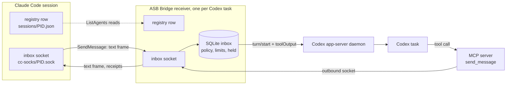

# ASB Bridge

A Codex plugin that lets Codex tasks and Claude Code sessions message each other on one machine.

Claude Code lists and messages its other sessions through its own local registry. This plugin registers each Codex task in that registry, so Claude finds the task with `ListAgents` and writes to it with `SendMessage`. Claude needs no flags, plugins, or launchers. A bundled MCP server gives the Codex side `list_sessions` and `send_message`. Messages travel over Unix domain sockets in private per-user directories. On Windows they travel over named pipes, and each receiver has a key file and checks an `auth` line (see [Windows](#windows)).

Separate Claude profiles have separate registries by default. To share discovery and messaging, use the explicit setup below.

## Requirements

- Stock Codex with its shared local app-server daemon. CLI tasks on the daemon and desktop tasks it owns work. Older desktop tasks use the desktop IPC fallback. CLI sessions started with `--no-daemon` have no inbox. Real-runtime checks cover Codex 0.159.0, 0.159.2, and 0.159.3.
- Linux, macOS, or Windows.
- Claude Code 2.1.224 or later, the first release with [cross-session messaging](https://code.claude.com/docs/en/cross-session-messaging).
- Bun on the PATH of both your terminal and the Codex app.

## Install

Install the plugin and both usage skills with ASB. Bun must be on your `PATH`.

Codex starts the bridge server with `bun` from the PATH of the Codex app. The server stays `required: true` because the `SessionStart` hook needs it before the first turn. If Codex cannot start Bun, it cannot start or resume tasks. See OpenAI's [required MCP setting](https://learn.chatgpt.com/docs/config-file/config-reference).

To recover, run `asb bridge uninstall --codex-home <home>` for the affected home. Uninstall needs Codex but does not need Bun. Then make Bun visible to desktop apps, for example with a link in `~/.local/bin` on Linux if that directory is on the app's PATH. Restart Codex and install the bridge again.

```bash
asb bridge install --codex-home ~/.codex --claude
```

Use `asb bridge install --all` for all detected providers. From a source checkout, use `scripts/asb bridge` in place of `asb bridge`. Without a target flag, `asb bridge install` prints the detected targets and usage, and changes nothing.

`asb bridge status` reports `bunOnAppServerPath` for each Codex home: `true`, `false`, or `null`. On Linux, it uses the HOME, CODEX_HOME, and PATH of running `codex ... app-server` processes; without CODEX_HOME, the home is `$HOME/.codex`. It resolves relative PATH entries from that process's working directory. `false` means at least one matching process cannot find an executable Bun file. `true` means all matching processes checked can find it. `null` means no process matches, the platform is not Linux, or process data cannot be read or verified. An unreadable app-server environment can hide its home, so it prevents a `true` result for any home. Status and install print a warning for `false`; the warning does not fail install. This check does not start Bun.

To install only the plugin manually from a local checkout:

```bash
codex plugin marketplace add /path/to/ASB
codex plugin add asb-bridge@asb
```

The plugin is not in the public Plugin Directory. As of 2026-10-03, OpenAI's [submission rules](https://developers.openai.com/plugins/deploy/submission) reject plugins with lifecycle hooks and accept only hosted HTTPS MCP servers. This plugin needs a `SessionStart` hook and a local MCP server, because the sockets and registry it uses live on your machine. It installs through its own marketplace until those rules change.

Codex ignores plugin hooks until you trust them. Open Plugins > ASB Bridge in Codex, review the two hooks, and trust both. Then restart Codex. After an ASB upgrade, run the install command again with the same targets.

A task registers when its `SessionStart` hook runs, which Codex does on the first turn. A fresh chat with nothing typed stays invisible to Claude. When Codex restarts, it ends every loaded task. An app-server task that registered before registers again without a turn when Codex loads it again. Desktop recovery probes registered tasks whose end times are within 30 seconds of the newest valid end in that home; other state waits for `SessionStart`. See [STARTUP.md](STARTUP.md).

## Usage skills

Type `/bridge` in Claude Code or `$bridge` in Codex to load the usage guide. Both skills load on demand only. The manual plugin commands above do not install them; use the ASB install command for the skill folders.

## Link Claude profiles

Choose an existing Claude config home as the shared home. Then run:

```bash
asb bridge link-claude /path/to/profile-home /path/to/shared-home
```

This opt-in command links only `<profile-home>/sessions` to `<shared-home>/sessions`. Both homes and both registry directories must already exist and belong to your user. The registry directories must have mode `0700`. Config homes can have mode `0755` or `0775`; the command does not change permissions. It refuses linked parents, public write access, unknown entries, and conflicting filenames. It accepts native `<PID>.json` peer records and `<PID>.<64-hex-hash>.key` IPC authentication files. It permits identical files and never overwrites a target file. An unknown heartbeat file causes refusal.

Native JSON metadata can have mode `0664` inside the private registry. JSON files must not be writable by everyone. IPC key files must have no group or other-user permissions. Setup keeps existing file permissions and creates new copies with mode `0600`.

The profiles share peer metadata and IPC authentication keys. Their app data, settings, transcripts, logins, model-provider credentials, and Codex homes stay separate. Every linked profile can discover and message peers in the shared registry. A message can start a turn in the receiving app under that app's own settings.

The command keeps the original directory at the private backup path that it prints, then creates the link. Repeat runs with the same target change nothing. Install and uninstall keep the link, shared registry, and backup. No background service or file mirror is added.

Setup checks for concurrent changes and refuses when it detects one. On failure, it restores the source when the path is free and removes only unchanged files that it copied. If another process creates the source path or changes a copied file, the error reports what it kept. Keep the backup until you have checked both profiles. It is a snapshot, not a live copy. To undo the link later, stop the affected peers, preserve any new shared entries, remove only the link, and restore the saved directory. Uninstall does not undo this opt-in setup.

The directory link follows the unpublished native registry behavior checked in Claude Code `2.1.303`. Claude has no dedicated registry override in that version. Future versions can change this behavior. See [PROTOCOL-COVERAGE.md](PROTOCOL-COVERAGE.md).

## Windows

The bridge runs on Windows with the same install command and the same tools. Bun must be on the `PATH` of the Codex app.

- `asb bridge install` finds `bun` and `codex` with `PATH` and `PATHEXT`. It runs a `codex.cmd` through `cmd.exe` and refuses a path or argument that has `"`, `%`, `^`, `&`, `|`, `<`, `>`, `!`, or a line break, with `This path cannot go to codex.cmd safely.`
- Each receiver listens on a named pipe `\\.\pipe\LOCAL\cc-msg-<32 hex>`, as Claude Code does. Its registry row has `pidDomain` `win32:<host name>` and a `procStart` from `GetProcessTimes`.
- Before the row, the receiver writes its key file `<pid>.<sha256 of the lower-case pipe path>.key` with a random `peerToken`. Each connection must start with `{"type":"auth","token":"<peerToken>"}`. The receiver closes a connection with a wrong or missing line before it reads a frame. The bridge sends this line to Claude sessions from their key files, and refuses to send when a key file is missing.
- Windows has no file modes, so the bridge does not check owners or modes there. It still refuses linked registry files and folders.
- Windows has no `SIGTERM`. When a task ends, the `SessionEnd` hook stops the receiver and then removes its row and key file.
- Codex desktop tasks use the desktop IPC pipe `\\.\pipe\codex-ipc`. A CLI task on the app-server daemon uses the daemon's socket file.
- Not on Windows: `asb bridge link-claude` (it refuses with `Linking Claude session folders is not supported on Windows.`) and the `bunOnAppServerPath` check (always `null`).

## Check that it works

In the Codex task, ask for the bridge status. The `status` tool reports a `replyAddress` and a `transport` of `app-server` or `desktop`. A `null` address means the receiver is inactive. The receiver starts at the task's first turn. Registered app-server tasks can recover when loaded; desktop recovery has the limits in [STARTUP.md](STARTUP.md). If the address stays `null` during a turn, the plugin hooks are not trusted or the `SessionStart` hook failed: check hook trust. No tool restarts the receiver.

In Claude Code, run `/list-agents`. The task appears as `codex-<title>-<suffix>`, or `codex-<directory>-<suffix>` before it has a title. When `CODEX_HOME` is not the default, its folder name replaces `codex`: `~/.codex-personal` gives `codex-personal-<title>-<suffix>`, and a folder such as `work` gives `codex-work-<title>-<suffix>`. A new task gets its title during its first turn, and the name changes at the end of that turn. Ask Claude to message it.

## How a message arrives

A message steers the task's active turn, or starts a turn when the task is idle. A running tool is never interrupted. The bridge marks the text as peer input. It grants no approval, and the task's own permissions still apply.



The app-server transport uses `turn/start` with `toolOutput`, which starts or joins a turn at tool authority. The bridge reads existing settings and leaves approval requests to your UI. If the observer connection drops, status and permissions are `unknown` while the bridge reconnects for up to 30 seconds. If recovery fails, the receiver exits. A lost delivery acknowledgement stays `unknown` and is never resent.

`send_message` addresses a peer by `sessionId`, not by name. An ambiguous registration is refused.

A `sessionId` that only the ASB engine lists (a session on another machine of the group, Linux) goes to the engine, which sends it to that machine. The bridge finds the engine through `$XDG_RUNTIME_DIR/asb/service.json`, so `.mcp.json` passes `XDG_RUNTIME_DIR` to the MCP server. The text limit is the same as for a local send. A refusal leaves the message `not-sent` with one of these reasons: `<machine> is not reachable. Nothing sent.`, `The session on <machine> is not available. Nothing sent.`, `Message too large for the other machine. Nothing sent.`, `Too many messages to this session just now. Nothing sent; wait or batch the text.`, or `<machine> refused the message. Nothing sent.` When the engine does not answer, the outcome is `unknown`. `notify_when_idle` to another machine is refused: `Idle subscriptions do not work across machines yet.`

## Control what arrives

The receive setting belongs to one task. When the permission modes of sender and receiver differ, a native dialog opens, also between turns. Held text reaches the model only after you release it.

| Setting | Behavior |
| --- | --- |
| `default` | Accept a matching permission mode, hold a differing one. Without a sender mode, accept only `prompting`. |
| `accept` | Accept everything and release held messages. |
| `hold` | Hold without expiry until an accepting setting applies or the session ends. |
| `refuse` | Drop messages and discard idle subscriptions. |

A message held by the mode comparison expires after 5 minutes. You set the expiry to `60s`, `5m`, `10m`, or `never` in the `inbox` dialog.

The sender sees Claude's status notices, among them `held`, `delivered`, `denied`, and `expired`. `delivered` means a held message was released. Ordinary acceptance sends no receipt. The `status` tool keeps Claude's explanation as `status_reason`.

## MCP tools

| Tool | Use |
| --- | --- |
| `list_sessions` | List local agents with ID, name, agent type, working directory, status, and start time. In an ASB machine group, the sessions on the other machines follow, with `remote: true`, `machine`, the name `<machine>-<session>`, and no working directory or start time. |
| `send_message` | Send text to one agent. Set `notify_when_idle` for one notice when that agent next goes idle. |
| `status` | Show the receiver and recent transport outcomes. |
| `inbox` | Open a dialog where you set the receive policy and hold expiry, or review the oldest held message. |

## Limits

- One message may reach 1,048,576 serialized characters. The sender refuses more before writing.
- A burst of 30 messages to one agent exhausts the budget. It refills one message every two seconds.
- At most 100 messages stay held and 50 accepted messages wait for Codex.
- `socket-written`, `accepted`, `started`, and `steered` report transport progress. A model reply is a separate event.
- Idle subscriptions fire once and last at most 12 hours.
- The bridge refuses attachments and says why. Send a shared path as text.
- The bridge does not lock files. Agree on file ownership before two agents edit one repository.
- App-server delivery uses the experimental `toolOutput` API. An incompatible runtime fails delivery; the bridge does not guess another protocol.
- Codex has no loaded-only subscription. A task that closes between the bridge's loaded check and `thread/resume` can be resumed by the observer. Reads and delivery never resume tasks.

What is missing compared with Claude Code is in [PROTOCOL-COVERAGE.md](PROTOCOL-COVERAGE.md). How other Codex and MCP bridges differ is in [COMPARISON.md](COMPARISON.md).

## Development

```bash
cd bridge
bun install --frozen-lockfile
bun run check
bun test
bun run build
bun run test:native
```

The tests that need Unix socket files, `/tmp`, file modes, links, or signals skip on Windows; the `bridge-windows` CI job runs the others there.

The plugin runs the bundled `dist/server.js` and `dist/hook.js`, and CI fails when they lag `src/`. Run `bun run build` after changing `src/`, and commit `dist/`. When you change a shipped bridge file, change the version in `package.json` and `.codex-plugin/plugin.json` together, because Codex caches an installed plugin by version. `bun run test:native` starts the installed Codex binary in a temporary home with a local model stub. See [Testing](PROTOCOL-COVERAGE.md#testing) for its modes and environment variables.

## License

MIT. See [LICENSE](LICENSE).

ASB Bridge is based on claude-uds-bridge by Leon Kohli (MIT). See LICENSE.
